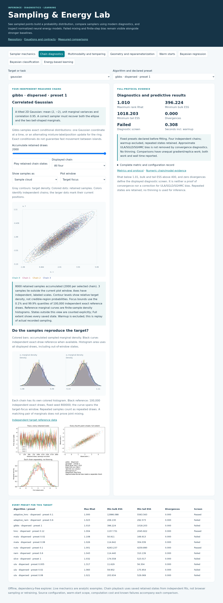
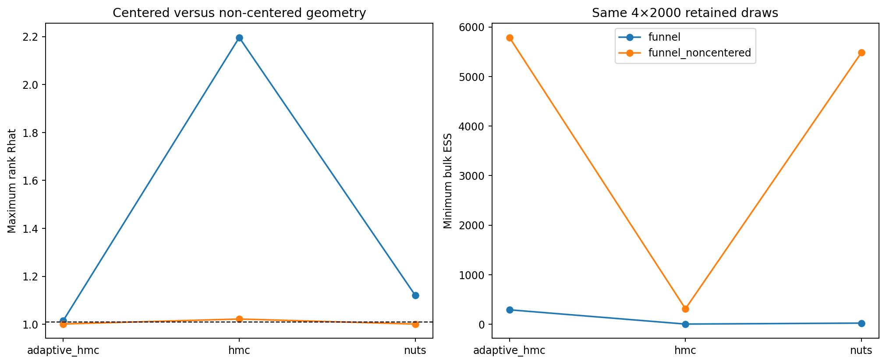
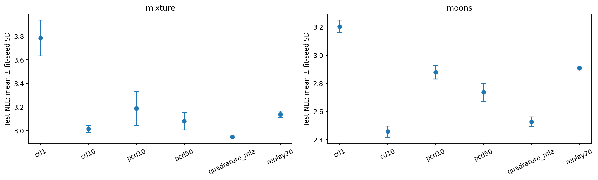

# Sampling & Energy Lab

**Learn what a sampler actually targets, measure whether it mixes, and use its output for Bayesian prediction and energy-based learning.**

This English laboratory rebuilds a single-coursework Langevin example into a
reproducible study of Markov chains, difficult posterior geometry and learned
energies. It connects transparent NumPy kernels to maintained Pyro NUTS and
ArviZ rank diagnostics, with real-data posterior prediction and normalized 2D
neural energy models. Methods are selected for what they explain; a newer name
alone does not establish better performance.



Open the [eight-concept explorer](docs/explorer.html) directly in your browser.
It needs no GPU, login or external service. For an HTTP preview, run
`python -m http.server 8000` from this directory and open
`http://localhost:8000/docs/explorer.html`. It starts with actual Gibbs samples over Gaussian target contours and marginal
histograms. The [sampling walkthrough](docs/sampling_walkthrough.md) explains
concrete Gaussian, mixture and curved-target comparisons. It includes live ULA
bias/Hamiltonian calculations, exact replay of recorded chain states, every measured preset and
all fitting seeds. [Hosting instructions](docs/publication.md) explain how to
share the same demo through GitHub Pages after you publish.

The [user interaction audit](docs/demo_review.md) documents exhaustive enabled
dropdown checks, representative joint slider settings and source-bound asset checks.

## Measured examples

- **84 sampler protocols, 336 independent chains:** 1,000 warmup and 2,000 retained
  draws per chain, across eight targets. Random-walk Metropolis, adaptive RWM,
  exact-conditional Gibbs, coordinate slice, ULA, corrected MALA, HMC, adaptive
  HMC, parallel tempering, Pyro NUTS and stochastic-gradient Langevin/Hamiltonian
  variants. Step-size, initialization and coordinate contrasts remain explicit.
- **Analytic or exact-draw targets:** correlated Gaussian, the original
  sinusoidally perturbed Gaussian, eight-mode ring, banana, and centered versus
  non-centered funnel. Exact rejection/reference sampling and a conjugate real
  regression posterior provide independent accuracy checks.
- **Real Bayesian tasks:** all 30 Wisconsin Diagnostic features and all 10
  Diabetes features, with training-only preprocessing, fixed independent splits,
  posterior predictive probabilities, proper scores and predictive intervals.
- **36 neural-energy fits:** CD-1, CD-10, PCD-10, PCD-50, replay-20 and quadrature
  maximum likelihood on a known mixture and noisy moons, with three fitting
  seeds. Validation-only selection, portable energy weights and independently
  refined test likelihoods make the negative-phase comparisons inspectable.



The centered funnel has severe mixing/divergence problems; non-centering with
adaptive HMC or NUTS gives much stronger diagnostics. A warm start can still
trap every chain in one mixture mode. ULA can converge to a biased stationary
law, and low Rhat cannot remove that bias. Approximate stochastic-gradient
presets also retain poor finite-budget mixing. These failures are part of the
study, not hidden behind a successful screenshot.



CD-1 is weaker on the mixture. Persistent/replay chains do not uniformly beat
CD-10; the quadrature baseline supplies a stronger normalized-likelihood
reference for this small model. The study does not claim high-dimensional
normalization, paper benchmark reproduction or image-generation quality.
Read the [full results](docs/results.md), [theory and contracts](docs/theory.md)
and [data/evaluation protocol](docs/data_and_protocols.md) before comparing scores.

## Run the laboratory

Python 3.10 or newer is required. CPU is sufficient for every included protocol.
The measured environment uses PyTorch 2.7.1, Pyro 1.9.1 and ArviZ 0.21.0.

```bash
python -m venv .venv
source .venv/bin/activate
python -m pip install -e '.[dev,notebooks]'
python -m pytest -q
sampling-lab sampling --quick --filter '"target": "gaussian"'
sampling-lab ebm --quick --filter '"method": "cd1"'
```

Quick fits are execution checks and remain under `results/smoke/`. Full reference
results, public safe arrays and small energy models are already included; no
private checkpoint or dataset download is needed for the explorer or walkthroughs.

```bash
sampling-lab sampling
sampling-lab ebm
python -m sampling_lab.reporting
python scripts/create_explorer.py
python scripts/validate_release.py
python scripts/execute_notebooks.py
```

The full preset files are [sampling.json](configs/sampling.json) and
[ebm.json](configs/ebm.json). To run alternatives, use a separate output directory
or checkout. Incomplete records are retained and rejected rather than silently
replaced; exact interrupted fitting is not promised. [Reproduction](docs/reproduction.md)
explains source bindings, computational budgets and public evidence.

## Navigate the repository

| Area | Entry |
|---|---|
| Sampler and target equations | [Theory](docs/theory.md) |
| Diagnostic interpretation | [Diagnostics](docs/diagnostics.md) |
| Executable English lessons | [Notebook curriculum](notebooks/README.md) |
| Every measured protocol | [Results](docs/results.md) |
| Scientific implementation review | [Component review](docs/component_review.md) |
| Data provenance and licenses | [Data protocol](docs/data_and_protocols.md) |
| Local release checks | [Release validation](docs/release_checklist.md) |
| Citation / contribution | [CITATION.cff](CITATION.cff) · [CONTRIBUTING.md](CONTRIBUTING.md) |

Owned code and procedural outputs are MIT licensed. Real datasets retain their
attribution and terms; original coursework stays privately preserved under
`legacy/originals`. No GitHub push or live deployment is performed by preparing
this local release.
